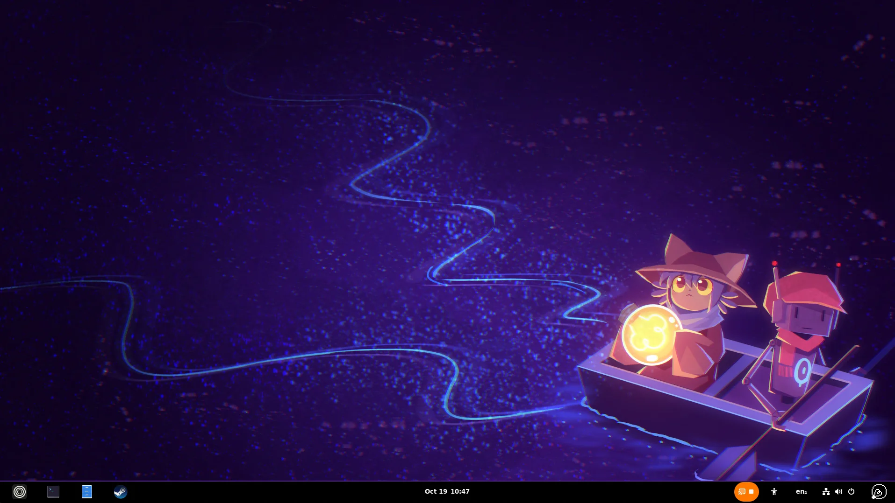
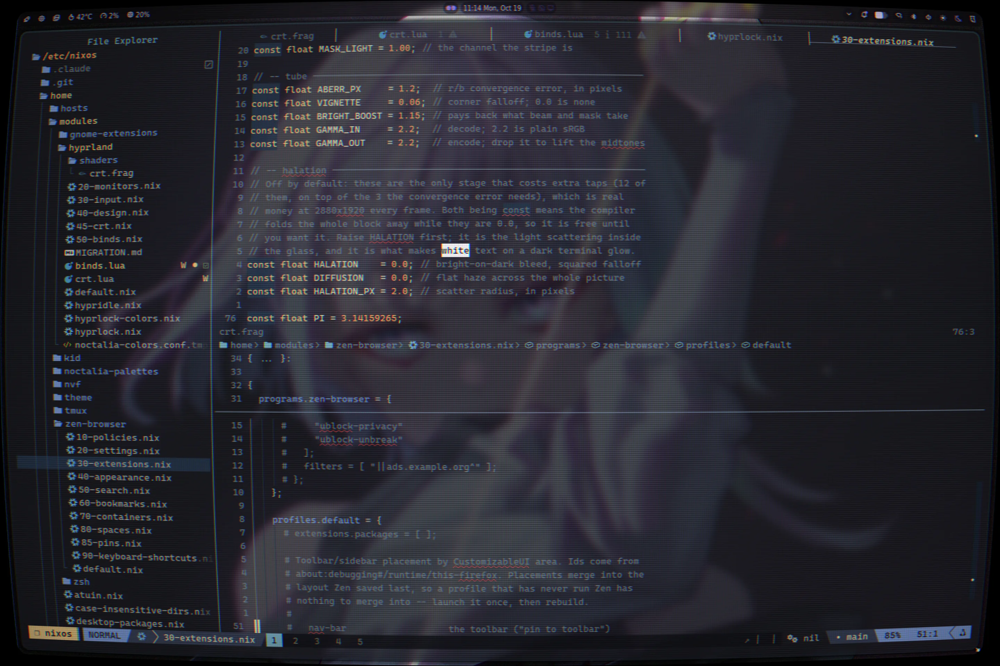
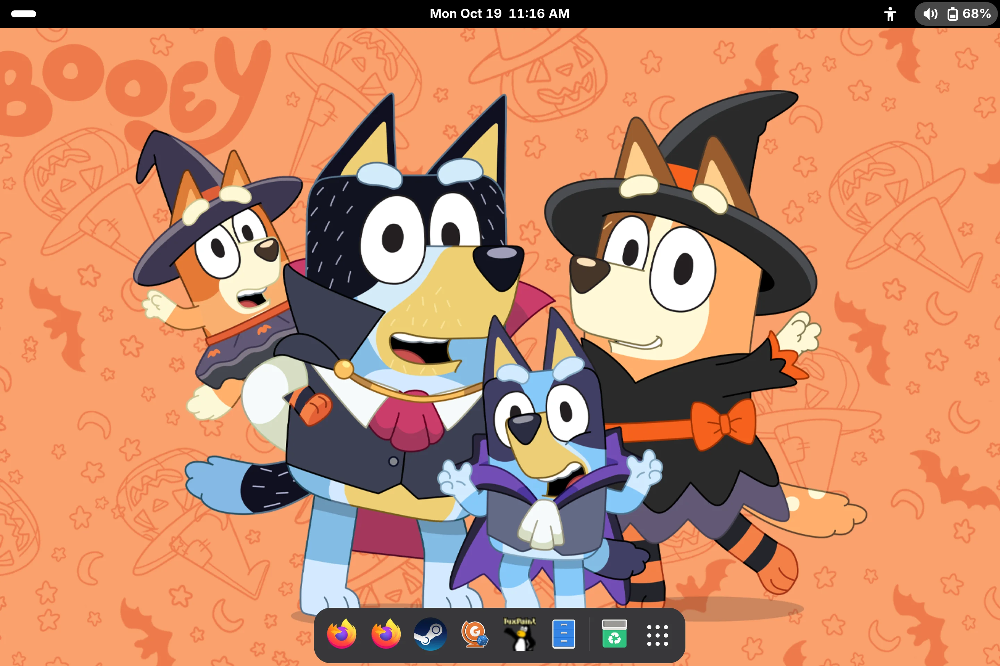
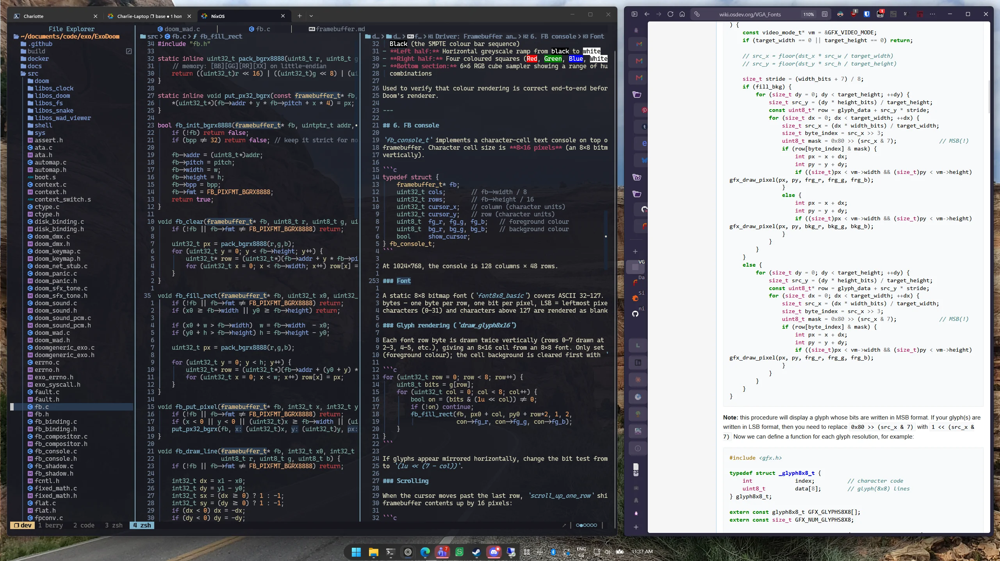
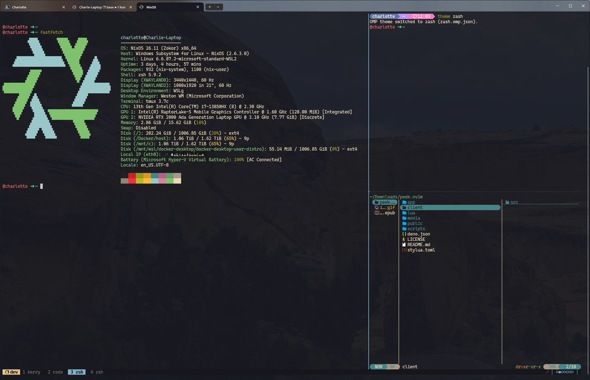

# nixos config

> nix flakes + home-manager configuration for five machines

[](https://github.com/LordHerdier/nixos-config/actions/workflows/flake-check.yml)
[](https://github.com/LordHerdier/nixos-config/commits/main)
[](https://github.com/NixOS/nixpkgs/tree/nixos-unstable)
[](LICENSE)

|                                            apthos — gnome, riced after OneShot                                            |                                       index — hyprland, with the CRT shader on                                        |                                        index — kiddo's session, plain and scaled up                                        |
| :-------------------------------------------------------------------------------------------------------------------------: | :-----------------------------------------------------------------------------------------------------------------------: | :--------------------------------------------------------------------------------------------------------------------------: |
|  |  |  |

every machine is a `mkHost` call that picks a profile; profiles compose
opt-in feature modules; modules stay single-concern. the payoff is that a new
host is a handful of lines, not a fork of an existing one — and the same
conventions (colemak, theming, module shape) hold everywhere from a bare-metal
laptop to a WSL dev shell.

colemak _everywhere_. system keyboard layout, kmonad homerow mods on the native
hosts, tmux/nvim/spotify-player navigation; it's all colemak, all sourced from
the same convention. see [keyboard](#keyboard) below.

the one deliberate exception is my sister's gnome session on index: plain
qwerty instead of colemak, plus accessibility tuning on top — 1.25x text
scaling, a bigger cursor, and dash-to-dock pinned to the bottom as a
persistent, easy-to-hit taskbar instead of the Activities overview. see
[`docs/kiddo.md`](docs/kiddo.md).

---

## contents

- [documentation](#documentation)
- [hosts](#hosts)
- [structure](#structure)
- [desktop — pine / index](#desktop--pine--index)
- [desktop — apthos](#desktop--apthos)
- [color tokens](#color-tokens)
- [shell](#shell)
- [editor](#editor)
- [keyboard](#keyboard)
- [flake inputs](#flake-inputs)
- [usage](#usage)

---

## documentation

this file is the tour. `docs/` has the deep dives: architecture and the
host-composition pattern, a catalog of every opt-in feature module, the kiddo
account end to end, secrets handling, and day-2 operations (rebuilding, updating
inputs, known in-flight work). start at [`docs/README.md`](docs/README.md).

---

## hosts

| host               | type                                       | description                                                                                               |
| ------------------ | ------------------------------------------ | --------------------------------------------------------------------------------------------------------- |
| **pine**           | native nixos                               | laptop — hyprland desktop, colemak/kmonad, steam                                                          |
| **index**          | native nixos                               | framework ai 300 laptop — hyprland for charlotte + gnome for kiddo, fingerprint reader, parental controls |
| **apthos**         | nixos vm (proxmox, gpu + nvme passthrough) | gnome desktop, autologin, streamed via sunshine/moonlight — riced after OneShot                           |
| **charlie-laptop** | nixos-wsl                                  | windows wsl — dev shell environment                                                                       |
| **nico**           | nixos-wsl                                  | windows wsl — minimal shell setup                                                                         |

see [`docs/hosts.md`](docs/hosts.md) for what each host actually turns on.

charlie-laptop's devshell in practice, building a toy exokernel across a few
terminal tabs and a reference doc:



---

## structure

```
.
├── flake.nix           # inputs + flake-parts wiring; the outputs live in parts/
├── parts/              # flake-parts modules (hosts + mkHost, overlay, devshell)
├── secretspec.toml     # secret declarations, backed by `pass` (see docs/secrets.md)
├── pkgs/                # custom derivations (the oneshot-* rice assets, dwl, ...)
├── modules/
│   ├── common/         # baseline (users, nix settings, packages, ssh, fonts, printing)
│   ├── features/       # opt-in capabilities (steam, tailscale, sunshine, ollama, syncthing, parental-controls, ...)
│   ├── profiles/       # module bundles (laptop, desktop-hyprland, desktop-gnome, dev-docker, wsl)
│   └── users/          # host-scoped extra system users (kiddo)
├── hosts/              # per-machine nixos configs
└── home/
    ├── charlotte.nix   # base home-manager entry point
    ├── kiddo.nix       # kiddo's home-manager entry point (index only)
    ├── modules/        # per-tool home configs (shell, editor, desktop, theme)
    ├── profiles/       # home-manager role bundles (desktop-hyprland, desktop-gnome, kid, wsl)
    └── hosts/          # per-machine home overrides
```

each module handles one concern. profiles compose modules into roles. hosts stay
small. full composition pattern (the `mkHost` function in `parts/hosts.nix`, extra
home-manager users, how a host picks up its modules) is in
[`docs/architecture.md`](docs/architecture.md).

---

## desktop — pine / index

| component   | choice                                                                               |
| ----------- | ------------------------------------------------------------------------------------ |
| compositor  | hyprland (wayland)                                                                   |
| bar         | noctalia                                                                             |
| launcher    | noctalia                                                                             |
| terminal    | kitty — CaskaydiaCove Nerd Font, 0.8 opacity, colors from `my.theme`                 |
| lock / idle | hyprlock + hypridle                                                                  |
| theming     | [noctalia](https://github.com/noctalia-dev/noctalia) — material you wallpaper colors |
| audio       | pipewire                                                                             |
| screenshot  | grim + slurp + swappy                                                                |

idle timeline: dim at 2.5 min → lock at 5 min → display off at 5.5 min → suspend
at 30 min.

<details>
<summary>deep dive: lua config + lock screen colors</summary>

hyprland is configured in **lua**, not hyprlang. `home/modules/hyprland/` sets
`configType = "lua"`, so home-manager generates `~/.config/hypr/hyprland.lua`
from `settings`, alongside `binds.lua` and `crt.lua` — hand-written lua loaded
through `extraLuaFiles`, because ~90 `hl.bind()` calls and a closure that
toggles a shader do not fit through nix attrs. hyprlock and hypridle are
separate programs with their own hyprlang parsers and are untouched by this.

two consequences worth knowing. hyprland picks its config format once at startup
and never re-checks, so switching a host to lua needs a logout, not a reload — a
reload makes it regenerate a stub `hyprland.conf` and the desktop comes up
looking unconfigured. and `hyprctl keyword` is rejected under the lua parser;
`hyprctl eval '<lua>'` replaces it, which is also the only way to inspect or
poke config state by hand. `home/modules/hyprland/MIGRATION.md` has the details
and the pre-switch verification recipe.

the lock screen's colors follow noctalia's current scheme rather than
`my.theme`. noctalia rewrites `~/.config/noctalia/colors.json` whenever the
scheme changes; `home/modules/hyprland/hyprlock-colors.nix` turns that into the
hyprlang variables hyprlock sources, and hypridle's `lock_cmd` regenerates it
immediately before locking — hyprlock reads its config at launch, so that is the
only moment it has to be right. if noctalia hasn't written colors.json yet, the
generator falls back to `my.theme`; that is the one place the declared palette
touches the hyprland desktop, and only as a cold start.

</details>

---

## desktop — apthos

a nixos vm on a proxmox host (twm), with a gpu and nvme passed through — not
bare metal. gnome (wayland), autologin, driven remotely over sunshine/moonlight.
riced after OneShot's in-fiction "World Machine" OS — pure black surfaces, one
saturated purple accent (`#9664ff`), square corners, inverted selection.

| component      | source                                                              |
| -------------- | ------------------------------------------------------------------- |
| cursor         | `pkgs/oneshot-cursors` → `home/modules/oneshot-cursors.nix`         |
| gtk2/3/4 theme | `pkgs/oneshot-gtk-theme` → `home/modules/oneshot-gtk.nix`           |
| icons          | `pkgs/oneshot-icons` → `home/modules/oneshot-icons.nix`             |
| wallpaper      | `pkgs/oneshot-wallpaper` → `home/modules/oneshot-wallpaper.nix`     |
| gnome console  | `home/modules/oneshot-console.nix` (+ `pkgs/gnome-console`)         |
| dock           | dash-to-dock, bottom panel mode (`home/profiles/desktop-gnome.nix`) |

<details>
<summary>deep dive: gtk theming internals + asset provenance</summary>

the gtk stylesheets' colors are build arguments, not literals.
`pkgs/oneshot-gtk-theme` takes six (`background`, `backgroundHover`, `accent`,
`accentDim`, `accentMuted`, `accentStandalone`) and remaps every call site by
value; `home/modules/oneshot-gtk.nix` fills them from the `oneshot` palette in
`my.theme`. building the package with no arguments still reproduces the
stylesheets byte for byte, so they stay readable as plain css.
`my.oneshot-gtk.palette` re-skins the whole theme — gtk2, gtk3, gtk4, the gnome
accent enum and the wallpaper letterbox — without touching a stylesheet.

both theme modules drive gnome through **dconf**, not home-manager's `gtk`
module: gnome-settings-daemon overrides anything written to
`gtk-3.0/settings.ini`, so settings.ini is the losing side of that race.

the gtk4 half needs a second install path on top of the theme directory —
libadwaita apps ignore `gtk-theme-name` outright, so `gtk-4.0/gtk.css` only
reaches nautilus/settings/text-editor from the _user_ stylesheet at
`~/.config/gtk-4.0/`. `oneshot-gtk.nix` installs it there.

user priority (800) beats an app's own stylesheet (600) on any node both of them
match, which is how a bare `* { border-radius: 0 }` squares nautilus' rounded
pathbar. the exception is **inheritance**: a libadwaita color property declared
on a descendant always beats one inherited from `:root`, whichever provider set
it. nautilus uses that to force a grey accent inside its file views, so
`theme/gtk-4.0/app-overrides.css` names the same nodes and puts the purple back.
it's concatenated onto `gtk.css` at install time, which keeps `gtk.css` itself a
plain copy of the upstream rice.

gnome console is the one app css can't finish: it hands its colors to vte
programmatically, so the 16 ansi slots are out of reach of any stylesheet at any
priority. they live in a "livery" instead — the color-scheme object console 49
added, stored as an undocumented `a{sv}` in gsettings, which
`home/modules/oneshot-console.nix` builds from `my.theme`. console 50.0 reads
that key with a tuple format string against what is actually a dictionary entry,
so the loader aborts on the first element and every custom livery is silently
dropped; `pkgs/gnome-console` is the one-character fix, and nothing else. drop it
when a nixpkgs bump fixes it upstream.

the oneshot palette collapses all six hues onto the accent, so console's grid is
monochrome purple by design — `my.oneshot-console.palette` points it at a
readable palette inside the same black-and-purple window. kitty, the terminal
actually used for work here, follows `my.theme.default` and is unaffected.

not covered: gnome shell's own chrome (top bar, overview, dash) isn't gtk and is
unaffected by any of this — it'd need a `gnome-shell.css` plus the user themes
extension.

optional: `my.oneshot-gtk.pixelFont = true;` swaps the interface font for
Terminus 10, the bitmap font the game's UI uses. off by default.

the icon theme only defines OneShot's _own_ icon names (`customize`, `jukebox`,
...), not freedesktop standard ones — guessing those would swap icons
desktop-wide. so it inherits Adwaita and mostly just makes the game's icons
available by name; it is not a wholesale icon swap.

`pkgs/oneshot-{cursors,icons,wallpaper}` are extracted game art, © Future Cat /
Komodo, marked `license = unfree` and vendored so a rebuild doesn't need the
game installed. `pkgs/oneshot-gtk-theme` is not — it's hand-written stylesheets
plus four original widget PNGs.

upstream for all four is `~/documents/code/oneshot-twm-rice`; each package's
default.nix names the `nix run .#...` command that regenerates it.

</details>

---

## color tokens

colors live in one place: `home/modules/theme/`, exposed as `my.theme`. app
modules ask for a token, not a hex value.

```
home/modules/theme/
├── default.nix     # the my.theme option tree
├── lib.nix         # role derivation + format helpers (noHash, rgbaHex, ...)
└── palettes/       # one file per palette, plain data
```

a resolved palette has two layers, and the split is the point:

| layer      | contents                                        | who reads it                                                                     |
| ---------- | ----------------------------------------------- | -------------------------------------------------------------------------------- |
| `.palette` | the 16 ansi colors plus `bg`/`fg`               | terminals, tuis, colorscheme plugins — they address colors by index or ansi name |
| `.roles`   | `accent`, `border`, `selectionBg`, `muted`, ... | ui chrome — "the accent" is a job, not a hue                                     |

roles default off the palette (`lib.nix`) and any palette can override one.
palettes also carry `.name` for apps that select a theme by string.

`my.theme.default` is the system palette, currently kanagawa, and every app
follows it: kitty, tmux, fzf, spotify-player and neovim all draw from the same
file. an app can still pin a different palette through its own option
(`my.kitty.palette`, `my.nvim.palette`).

`catppuccin-mocha` and `gruvbox-nightfox` are kept as palettes because they are
what kitty and neovim used to carry inline, and either can be pinned back on one
line.

nvf gets the theme through `extraSpecialArgs`, not `config`: it runs its own
`evalModules`, so home-manager's config is not in scope inside
`home/modules/nvf/*.nix`.

**scope.** this governs the terminal/editor/tui stack and apthos's gtk theme. it
does _not_ govern the hyprland desktop — noctalia derives its colors from the
wallpaper at runtime, and that is the source of truth there. the bar, the shell
and the lock screen all follow noctalia; see `hyprlock-colors.nix` for how the
lock screen picks them up.

hyprland's own window border colors are the one exception. they are fed from
`my.theme`'s roles in `home/modules/hyprland/40-design.nix` — `border` and
`accentDim` for the two ends of the active gradient, `borderInactive` for the
idle one — which the lua config makes cheap, since a gradient there is
structured data (`col.active_border =
{ colors = [ ... ]; angle = 120; }`)
rather than an `"rgba(..) rgba(..) 120deg"` string. noctalia cannot drive them:
its hyprland template has to be enabled in its gui, defines no foreground color,
and its post-process step edits `~/.config/hypr/hyprland.conf`, which no longer
exists here at all.

so the border is _declared_ where the rest of this desktop is wallpaper-derived
at runtime. that is a deliberate trade — tokenized and consistent with the
terminal stack, at the cost of being the one piece of hyprland chrome that does
not follow the wallpaper.

---

## shell

| tool          | role                                                                    |
| ------------- | ----------------------------------------------------------------------- |
| zsh           | shell — completions, autosuggestions, syntax highlighting               |
| oh-my-posh    | prompt                                                                  |
| tmux          | multiplexer — colors from `my.theme`, vim pane nav, session persistence |
| atuin         | shell history sync                                                      |
| zoxide + yazi | directory navigation + file manager                                     |



---

## editor

neovim via [nvf](https://github.com/notashelf/nvf):

- lsp + format-on-save for nix, lua, python, typescript, c/c++, bash, and more
- telescope, neo-tree, treesitter, todo-comments, noice, which-key
- nightfox theme, palette from `my.theme` (`my.nvim.palette`)

---

## keyboard

colemak system-wide. on native hosts, [kmonad](https://github.com/kmonad/kmonad)
adds homerow mods:

```
hold a → meta    hold s → alt    hold d → shift    hold f → ctrl
hold j → ctrl    hold k → shift  hold l → alt      hold ; → meta
```

`g`/`h` toggle a nav layer that maps `hjkl` → arrow keys.

---

## flake inputs

| input                     | purpose                                          |
| ------------------------- | ------------------------------------------------ |
| nixpkgs (unstable)        | package set                                      |
| home-manager              | user environment management                      |
| flake-parts               | flake structure helpers                          |
| nixos-wsl                 | wsl integration                                  |
| nixos-hardware            | framework ai 300 hardware module                 |
| nvf                       | declarative neovim configuration                 |
| noctalia                  | hyprland bar/shell/launcher + theming            |
| qylock                    | sddm greeter theme (index)                       |
| spicetify-nix             | patches the spotify client for `my.theme` colors |
| dotfiles                  | bin scripts, oh-my-posh themes, yazi config      |
| hacky-tts, hacky-launcher | small personal tools, each its own flake         |
| forgejo-cli               | cli for a self-hosted forgejo instance           |
| zen-browser               | zen browser package                              |

---

## usage

```sh
# rebuild current machine
sudo nixos-rebuild switch --flake /etc/nixos#$(hostname)

# update dotfiles input
sudo nix flake lock --update-input dotfiles /etc/nixos
```
