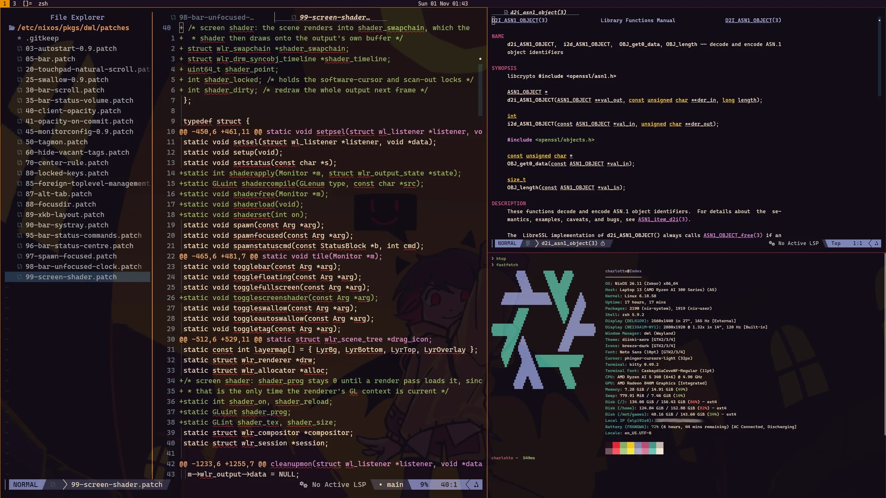
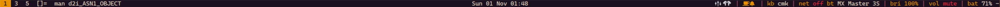
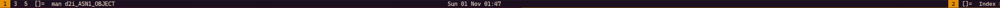
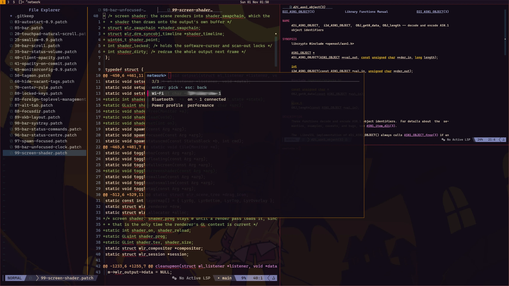
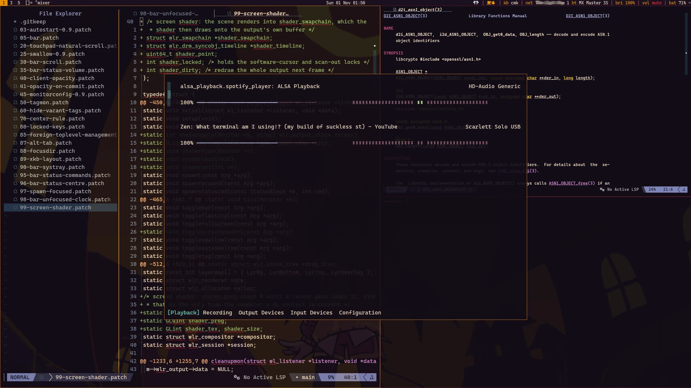
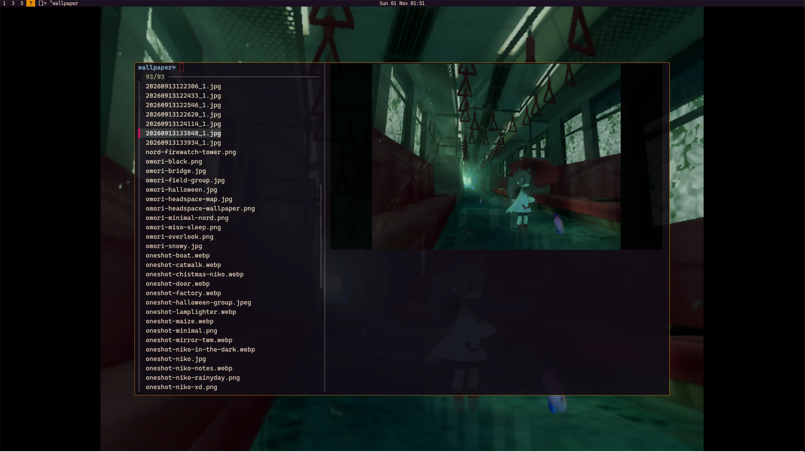
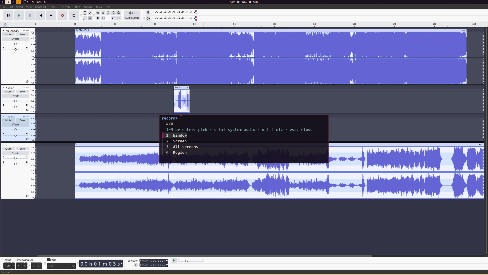
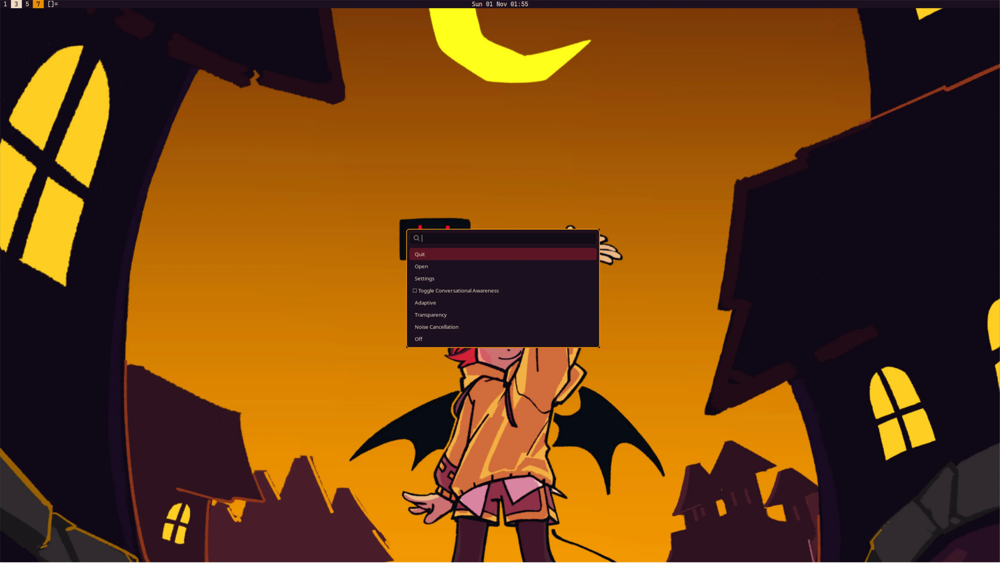
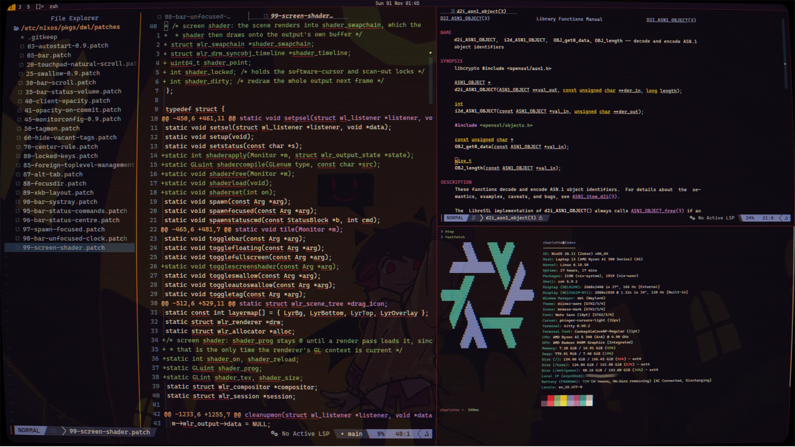

# dwl

[dwl](https://codeberg.org/dwl/dwl) built from nixpkgs' `dwl` with this
directory's `config.h` and the patches in `patches/`.



The bar: tags in use, layout, title, centred clock, tray, then the slstatus
blocks (`kb`, `net`, `bri`, `vol`, `bat`). Below it, the same bar across both
monitors: the unfocused one keeps only its tags and the clock.




<details>
<summary>Popups</summary>

| Network (Super+Alt+A)                                           | Mixer (Super+A)                                              |
| :-------------------------------------------------------------: | :----------------------------------------------------------: |
|        |            |
| **Wallpaper picker (Super+Alt+4)**                              | **Recording picker (Super+Shift+R)**                         |
|  |  |
| **Tray menu (right click, through wofi)**                       | **CRT shader (Super+Shift+G)**                               |
|         |           |

</details>

| File          | Purpose                                                                                                                             |
| ------------- | ----------------------------------------------------------------------------------------------------------------------------------- |
| `default.nix` | `dwl.override { configH = ./config.h; }` plus every `patches/*.patch`; the screen shader path and the fallback colours go in as `-D` flags |
| `config.h`    | The dwl config (replaces upstream `config.def.h` at build time)                                                                     |
| `clangd.nix`  | Generates a `.clangd` so LSP works on `config.h` (see below)                                                                        |
| `patches/`    | Patches applied to the dwl source, in filename order                                                                                |

The rest of the session lives elsewhere:

- `modules/features/dwl/`: the login session (`dwl.desktop`, `dwl-session`,
  `dwl-startup`, the `dwl-session` systemd target), the `dwl-*` helper scripts
  in `scripts/`, mako and the portals. It writes the `my.theme` colour files
  dwl reads at runtime and is imported by Index only (`parts/hosts.nix`).
- `pkgs/slstatus/`: the bar's status line, piped into `dwl -s` by
  `dwl-session`. Its `config.h` holds the bar's click and scroll regions.
- `parts/overlay.nix`: sets `screenShader` to hyprCRT's `crt.frag`.

## Base version

Everything is written against **dwl v0.9**, the version in nixpkgs
(`src = https://codeberg.org/dwl/dwl/archive/v0.9.tar.gz`):

- tag `v0.9` (tag object `e2e518b`)
- commit `98bea2c27f99c549023fb394bfd983a439d8ccb9`

The patches apply in sequence, so each one is against v0.9 _plus the patches
before it_, not against pristine v0.9 (e.g. `30-bar-scroll` and
`40-client-opacity` expect the bar and swallow changes to already be there).

## Patches

Applied in filename order; the number prefix is the order.

> Most of the patches from dwl-patches have been ported by hand for 0.9

| Patch                                  | Source                                                              | What it does                                                                                                                                                                                                                                                                                                                                                                                                                                                                                                                                                                                                                                          |
| -------------------------------------- | ------------------------------------------------------------------- | ----------------------------------------------------------------------------------------------------------------------------------------------------------------------------------------------------------------------------------------------------------------------------------------------------------------------------------------------------------------------------------------------------------------------------------------------------------------------------------------------------------------------------------------------------------------------------------------------------------------------------------------------------- |
| `03-autostart-0.9.patch`               | dwl-patches `autostart` (v0.9 version)                              | Adds an `autostart[]` command list to `config.h`, run when dwl starts                                                                                                                                                                                                                                                                                                                                                                                                                                                                                                                                                                                 |
| `05-bar.patch`                         | dwl-patches `bar`                                                   | Built-in status bar (tags, layout symbol, title, status text) drawn with fcft via `drwl.h`. Adds `showbar`, `topbar`, `fonts[]`, `colors[][3]` (`SchemeNorm/Sel/Urg`), the `togglebar` function and `ClkTagBar`/`ClkLtSymbol`/`ClkTitle` button targets                                                                                                                                                                                                                                                                                                                                                                                               |
| `20-touchpad-natural-scroll.patch`     | local                                                               | `natural_scrolling` applies only to touchpads (devices with a tap finger count), so mice keep normal scrolling                                                                                                                                                                                                                                                                                                                                                                                                                                                                                                                                        |
| `20-touchpad-natural-scroll.patch`     | local                                                               | `natural_scrolling` applies only to touchpads (devices with a tap finger count), so mice keep normal scrolling                                                                                                                                                                                                                                                                                                                                                                                                                                                                                                                                        |
| `25-swallow-0.9.patch`                 | dwl-patches `swallow` (v0.9 version)                                | Window swallowing: a terminal is hidden while a GUI app it launched runs. Adds `isterm`/`noswallow` rule columns, `enableautoswallow`, `swallowborder`, `toggleswallow`, `toggleautoswallow`                                                                                                                                                                                                                                                                                                                                                                                                                                                          |
| `30-bar-scroll.patch`                  | local, not from dwl-patches                                         | Scrolling over the bar cycles tags (wrapping) via a new `shiftview`; hooks `axisnotify`                                                                                                                                                                                                                                                                                                                                                                                                                                                                                                                                                               |
| `35-bar-status-volume.patch`           | local                                                               | Scrolling over the status text runs `statusaxes[]` from `config.h` instead of cycling tags. Nothing is bound there now (volume moved to slstatus's `^us`/`^ds` region), so it just stops tag cycling over the status                                                                                                                                                                                                                                                                                                                                                                                                                                  |
| `40-client-opacity.patch`              | dwl-patches `client-opacity` + local edits                          | Per-window opacity: an `alpha` column in `rules`, `default_opacity`, and `setopacity` to adjust the focused window at runtime                                                                                                                                                                                                                                                                                                                                                                                                                                                                                                                         |
| `41-opacity-on-commit.patch`           | local                                                               | Reapplies a client's opacity on every surface commit, since wlroots resets it when the surface commits a new buffer                                                                                                                                                                                                                                                                                                                                                                                                                                                                                                                                   |
| `41-opacity-on-commit.patch`           | local                                                               | Reapplies a client's opacity on every surface commit, since wlroots resets it when the surface commits a new buffer                                                                                                                                                                                                                                                                                                                                                                                                                                                                                                                                   |
| `45-monitorconfig-0.9.patch`           | dwl-patches `monitorconfig` (0.9) + local edits                     | Adds `resx resy rate mode adaptive` columns to `monrules`. Locally changed to match `resx`/`resy`/`rate` (within 0.5Hz) against the output's real modes, not to build custom timings, and to fall back to the preferred mode when nothing matches. `mode = n` still picks the nth mode; `-1` is still a custom mode                                                                                                                                                                                                                                                                                                                                   |
| `50-tagmon.patch`                      | local, not from dwl-patches                                         | `tagmons[]` maps each tag to an output name, like Hyprland workspace rules. `view`/`tag` move to that output when it is enabled, a new output starts on its first mapped tag and pulls in clients on its tags, and bar scrolling (`shiftview`) skips tags that live on another output                                                                                                                                                                                                                                                                                                                                                                 |
| `60-hide-vacant-tags.patch`            | dwl-patches `hide_vacant_tags`                                      | The bar only draws tags that are selected or have clients, so each monitor shows just the tags in use there                                                                                                                                                                                                                                                                                                                                                                                                                                                                                                                                           |
| `70-center-rule.patch`                 | local                                                               | Adds an `iscentered` rule column: matching floating clients open centred on their monitor's usable area                                                                                                                                                                                                                                                                                                                                                                                                                                                                                                                                               |
| `80-locked-keys.patch`                 | local                                                               | While a screen locker is active, only the keysyms in `lockedkeys[]` (media and brightness keys) still reach compositor binds; the rest of `keys` stays dead                                                                                                                                                                                                                                                                                                                                                                                                                                                                                           |
| `80-locked-keys.patch`                 | local                                                               | While a screen locker is active, only the keysyms in `lockedkeys[]` (media and brightness keys) still reach compositor binds; the rest of `keys` stays dead                                                                                                                                                                                                                                                                                                                                                                                                                                                                                           |
| `85-foreign-toplevel-management.patch` | dwl-patches `foreign-toplevel-management` (2024, rewritten for 0.9) | `wlr-foreign-toplevel-management-v1` alongside 0.9's read-only ext list, so tools like `wlrctl` can list, activate, close and fullscreen windows. Activating goes _to_ the window (its monitor switches to its tags via `view`, so `tagmons[]` applies, then it is focused) instead of upstream's pulling it onto the current tag; a swallowed terminal redirects to the app swallowing it; ignored while locked. Reports activated/fullscreen state and output enter/leave. Used by `dwl-windows` (Super+Alt+Tab)                                                                                                                                    |
| `87-alt-tab.patch`                     | local                                                               | Windows-style Alt+Tab as `mrucycle` (Super+Tab / Super+Shift+Tab): the first press snapshots the focus stack (most recently used first, all tags and outputs, swallowed terminals left out), each press focuses the next entry, switching that output's tags without `view()` so the previous tagset survives. Releasing the bind's modifier (`keypressmod`) keeps the window shown; Escape goes back. Either way every output's tags and the focus-stack order are restored first, so only the chosen window moves to the front. Adds `Monitor.mrutags`                                                                                              |
| `88-focusdir.patch`                    | local                                                               | Directional focus as `focusdir` (`{.i = WLR_DIRECTION_*}`), like Hyprland's `movefocus`: picks the visible client on `selmon` whose centre lies that way, preferring ones that overlap across the direction, then the smallest gap, then the most recently focused. With none (or a fullscreen window focused) it moves to the adjacent output, wrapping to the far side of the layout (or the far side of this output, if it is the only one), and focuses the client nearest the edge it entered from. In monocle it falls back to `focusstack`                                                                                                     |
| `89-xkb-layout.patch`                  | local                                                               | Keyboard layout switching as `switchxkblayout` (`{.i = +1}` steps to the next xkb layout, wrapping), like Hyprland's `switchxkblayout`. Sets the layout on one physical keyboard, since wlroots syncs a member's layout to the rest of the group but not the group's to its members; tracks the keyboards in a `keyboards` list for that, and puts newly attached ones on the active layout. Whenever the layout changes it writes its name (`English (Colemak)`) to `$XDG_RUNTIME_DIR/dwl-xkb-layout` and runs `xkblayoutcmd[]` from `config.h`, which slstatus uses for the bar's `kb` block                                                        |
| `90-bar-systray.patch`                 | dwl-patches `bar-systray` (0.7, ported to 0.9)                      | StatusNotifierItem system tray at the right edge of the bar (libdbus). Left-click activates an icon, right-click shows its menu through `dmenucmd[]` (`wofi --dmenu`). Adds `showsystray`, `systrayspacing`, `ClkTray`. `dbus.c` carries its own `die`/`ecalloc` since 0.9's `util.h` can only be included once. Status-text and tray hit areas are computed separately, including for `shiftview`/`statusaxes` scrolling                                                                                                                                                                                                                             |
| `95-bar-status-commands.patch`         | local, syntax from dwlb                                             | Inline status-text commands: `^fg(rrggbb[aa])`/`^bg(...)` colour what follows (empty argument reverts), `^lm(cmd)`/`^mm`/`^rm`/`^us`/`^ds` open a click/scroll region closed by the same command with no argument, `^^` is a literal `^`. Region commands run via `sh -c` and end at the first `)`. Unmodified clicks/scrolls outside a region (or with no command for that button) fall back to `ClkStatus` bindings and `statusaxes[]`. Status input grows from 256 to 1024 bytes                                                                                                                                                                   |
| `96-bar-status-centre.patch`           | local                                                               | `^ct()` status command: toggles drawing the following status text in the middle of the bar instead of at the right edge. The window title stops short of it, and centred blocks keep their colours and click/scroll regions. Used for slstatus's clock                                                                                                                                                                                                                                                                                                                                                                                                |
| `97-spawn-focused.patch`               | local                                                               | `spawnfocused`: `spawn`, but with `DWL_FOCUS_GEOM="x,y wxh"` (slurp's format, layout coordinates, borders included) set to the focused client's box. Lets `dwl-record` (Super+Shift+R) record just that window before its picker popup takes focus                                                                                                                                                                                                                                                                                                                                                                                                    |
| `98-bar-unfocused-clock.patch`         | local                                                               | Unfocused monitors hide the system tray and right-hand status but still draw `^ct()` centred blocks (the clock)                                                                                                                                                                                                                                                                                                                                                                                                                                                                                                                                       |
| `99-screen-shader.patch`               | local                                                               | `togglescreenshader` (Super+Shift+G) runs a fragment shader over each output's final frame, using the same contract as Hyprland's `decoration:screen_shader` (`tex`, `v_texcoord`, `fullSize`), so hyprCRT's `crt.frag` (`screenshader` in `config.h`, set by `default.nix`) runs unchanged. The scene renders into an off-screen swapchain and a raw GLES2 pass draws it onto the output's buffer, so it needs the GLES2 renderer. While it is on, the cursor is drawn in software and direct scan-out is off. The file is re-read each time the shader is enabled; if it fails to compile, the error goes to stderr and the shader turns itself off |
| `99-theme-colours.patch`               | local                                                               | `loadcolors` reads `name=#rrggbb` lines (`bg fg surface border_inactive muted accent accent_fg border urgent`) at startup and on `SIGUSR2`, then repaints the root background, client borders, tray and bars, so a palette change needs no rebuild or restart. `dwl-theme NAME` installs a palette as the user override and signals dwl; a rebuild that changes `my.theme.default` signals it from an activation script |

`05-bar.patch` is a `diff -ruN` regenerated from a working tree rather than a
verbatim wiki patch; it also changes `rootcolor` to black and drops
`bordercolor`/`focuscolor`/`urgentcolor` in favour of `colors[][3]`.

## Config (`config.h`)

Based on `config.def.h` with patch hunks merged in by hand. Notable settings:

- **Look**: 1px borders, bar at the top, `monospace:size=12`, focus follows
  the mouse (`sloppyfocus`), windows 90% opaque (`default_opacity`). Colours
  (`colors[]`, `rootcolor`, and `sepcolors` for the `|` between tray and
  status) are read at startup and on `SIGUSR2` from
  `$XDG_STATE_HOME/dwl/colors`, else `/etc/dwl/colors` (`99-theme-colours`).
  `modules/features/dwl` writes the latter from `my.theme.default` and a file
  per palette for `dwl-theme`; with neither file they fall back to the
  `COL_*` macros, the OneShot palette.
- **Tags**: ten, named `1`-`10`.
- **Autostart**: a `kitty` running the `t` zsh function (loops over tmuninator
  confs)
- **Rules**: `kitty` is a swallowing terminal; `floatterm` (Super+T) floats and
  never swallows; `modal` floats centred and never swallows. Control popups are
  kittys with that class, spawned through `MODAL(name)`, which runs
  `dwl-modal name`. Each popup's size and command are set once, by name, in
  `modules/features/dwl/scripts/dwl-modal.sh`, which the bar's click regions
  also call. Pressing the same bind again closes the popup.
- **Monitors**: mirror `home/modules/hyprland/monitors.lua`. Docked, DP-4
  (2560x1440@165.08, scale 1) sits at `0,0` and eDP-1 (2880x1920@120, scale
  1.33) to its right at `2560,0`. Rules apply as outputs appear, so there is no
  dock detection and no reload. `tagmons[]` puts odd tags on DP-4 and even tags
  on eDP-1; undocked, every tag is on eDP-1. `mfact` 0.55, tile layout; layouts
  `[]=`, `><>`, `[M]`.
- **Input**: Colemak and QWERTY (`us,us`/`colemak,`), Colemak first;
  `Super+Alt+K` switches and the bar's `kb` block shows which is active. 25/s
  repeat after 600ms, natural scrolling and tap-to-click on trackpads.
- **Keybinds**: ported from the old Hyprland binds
  (`home/modules/hyprland/binds.lua`). `Super` is the main modifier. Colemak
  `n/i/u/e` (and the arrows) move focus by direction (`88-focusdir`), crossing
  to the next output at the edge and wrapping. `Super+Tab`/`Super+Shift+Tab`
  cycle windows in recently used order (`87-alt-tab`). dwl-only
  master/layout/monitor/opacity binds live on `Super+Ctrl` (`Super+Ctrl+O` and
  `Super+Ctrl+Shift+O` step opacity by 0.05). Wallpaper cycling is
  `Super+Alt+1/2/3` (`dwl-wallpaper next|prev|rand`); `Super+Alt+4` opens
  `dwl-wallpaper-pick`, an fzf menu in a `MODAL` popup that previews each
  wallpaper live as you move through it (Enter keeps, Esc reverts).
- **Popups and toggles** (`MODAL` unless noted):

  | Bind            | Does                                                                         |
  | --------------- | ---------------------------------------------------------------------------- |
  | `Super+V`       | Clipboard history (cliphist)                                                 |
  | `Super+.`       | Emoji picker                                                                 |
  | `Super+Alt+Tab` | Window switcher (wlrctl, `85-foreign-toplevel-management`)                   |
  | `Super+A`       | `wiremix` mixer                                                              |
  | `Super+Alt+A`   | Network menu: Wi-Fi, Bluetooth, power profile                                |
  | `Super+O`       | Session menu                                                                 |
  | `Super+W`       | Notifications                                                                |
  | `Super+Alt+W`   | Do not disturb (`dwl-dnd`, no popup)                                         |
  | `Super+K`       | Calendar                                                                     |
  | `Super+Shift+N` | Night light (`dwl-nightlight`)                                               |
  | `Super+Shift+I` | Caffeine (`dwl-caffeine`)                                                    |
  | `Super+Alt+K`   | Colemak/QWERTY (`89-xkb-layout`)                                             |
  | `Super+Alt+S`   | AirPods noise control (`dwl-airpods`)                                        |
  | `Super+Shift+R` | Recording picker: window, screen, all screens or region (`97-spawn-focused`) |
  | `Super+Shift+G` | CRT screen shader (`99-screen-shader`)                                       |
  | `Super+L`       | Lock (`qylock-lock`); `Super+Shift+L` quits dwl                              |

- **`NOCTALIA_STUB(verb)`**: binds that used to call `noctalia msg <verb>`. They
  currently run `true` as a placeholder. Still unported: `Super+Shift+Space`
  (`/pan` launcher), `Super+,` (settings) and `Super+Shift+D` (theme mode).
- **Volume** keys step 5% and `Super`+scroll steps 1%, via `wpctl`, then run
  `dwl-bar-refresh` (`pkill -USR1 slstatus`) to redraw the bar. Brightness keys
  do the same through `brightnessctl`. Media and brightness keys still work
  while locked (`lockedkeys[]`, `80-locked-keys`).
- **Bar**: status clicks and scrolls come from click regions in
  `pkgs/slstatus/config.h` (95-bar-status-commands.patch), not from
  `buttons[]`/`statusaxes[]`:

  | Block         | Left click    | Middle click | Right click                                     | Scroll   |
  | ------------- | ------------- | ------------ | ----------------------------------------------- | -------- |
  | notifications | notifications | clear all    | do not disturb                                  |          |
  | `net`         | network menu  |              | on the Wi-Fi name or `bt`, toggle just that one |          |
  | `bri`         | night light   |              | caffeine                                        | 5% steps |
  | `vol`         | mixer         |              | mute                                            | 5% steps |
  | clock         | calendar      |              |                                                 |          |

  `bri` is drawn in the accent colour while night light is on. The clock is
  centred (`96-bar-status-centre`) and stays on unfocused monitors, which hide
  the tray and the rest of the status (`98-bar-unfocused-clock`).

## Adding or updating a patch

1. Drop a `.patch` into `patches/`. Every file there is applied automatically.
   Use a number prefix to control order.
2. Patches are applied **before** `config.h` is copied in, so any `config.def.h`
   hunks (new keybinds, rule columns, variables) do not reach the build. Port
   them into `config.h` yourself.
3. On a nixpkgs bump to a new dwl release, patches can fail to apply and
   `config.h` can fall behind. Diff against the new `config.def.h`
   (`nix build nixpkgs#dwl.src`), refresh the patches, and update the base
   commit above.

## Editing `config.h` with LSP

`config.h` has no `#include`s: `dwl.c` pastes it in after the types it needs, so
clangd alone reports `Rule`, `Key`, `tile`, ... as undefined. `clangd.nix`
builds a preamble from the _patched_ dwl source and the right include flags:

```sh
nix run .#dwl-clangd   # writes pkgs/dwl/.clangd (gitignored, holds store paths)
```

Re-run it after changing patches. `.clang-format` in this directory is the
formatting config for `config.h`.
